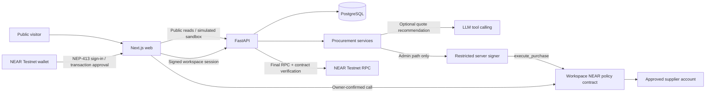

# RestockOS architecture

## Request and data flow

## Frontend

`apps/web/app` contains the App Router page entrypoints. `apps/web/components/workspace.tsx` owns the dashboard shell, TanStack Query requests, wallet connection, page views, and owner controls. The public landing section and seeded sandbox are visible without credentials when the public demo flag is enabled. Authentication sessions are short-lived and stored in tab session storage. The browser only receives signed session tokens, never wallet seeds or the admin signing key.

The installed `@hot-labs/near-connect` 0.12 connector supports Testnet wallet discovery, sign-in, `signMessage`, `signAndSendTransaction`, and disconnection. Wallet ownership is authenticated by signing the server-issued NEP-413 message. Transactions use the Testnet network explicitly.

## API and authentication

`apps/api/restock/main.py` exposes REST endpoints. Pydantic request validation lives in `schemas.py`; SQLAlchemy 2 models live in `models.py`; procurement decisions and state transitions live in `procurement.py`; `chain.py` handles RPC and evidence checks.

There are three identity paths:

- Anonymous public demo requests get read access to the seeded `admin-demo` data when `DEMO_ENABLED` and `PUBLIC_DEMO` are true. Only `POST /demo/run` is anonymously mutating, and it produces a `simulated` order without any chain operation.
- Wallet sessions are HMAC-signed by `SESSION_SECRET`, expire after 12 hours, and contain the wallet account, role, and workspace ID. The API verifies the one-time challenge through `near-api-js` and Testnet RPC.
- The original `OWNER_TOKEN` remains the admin bearer credential for the seeded workspace. `AUTOMATION_TOKEN` may run normal agent scans but is not an admin. `ADMIN_ACCOUNT_IDS` explicitly grants admin role to wallet-authenticated account IDs.

The API stores business state in PostgreSQL. `db.py` attaches an authenticated workspace ID to the SQLAlchemy session and applies tenant criteria to every scoped ORM entity. The session flush hook rejects writes carrying a different workspace ID. Global tables are limited to workspace identity and short-lived authentication challenges.

## Multi-tenancy and migration

`workspaces.id` is the tenant root. Products, suppliers, quotes, inventory movements, policies, agent runs, purchase orders/items, blockchain transactions, and audit events all have a non-null workspace key. Product SKU and supplier name/account uniqueness is workspace-local. The existing single-tenant records are assigned to `admin-demo` by migration `2c15d3a8f641`.

Queries must not accept workspace IDs from request bodies or URL parameters as authority. The signed session selects the tenant. Record IDs are globally unique, and query criteria prevent retrieving another workspace's rows even if an ID is guessed.

## Procurement workflow

1. `analyze_inventory` finds the most urgent shortage, excluding products with open normal orders.
2. `request_supplier_quotes` creates three structured offers from the seeded adapter.
3. `evaluate_quotes` filters against the workspace allowlist and scores price, delivery and reliability.
4. The optional LLM can recommend only among compliant quote IDs. Invalid output falls back to deterministic ranking.
5. The deterministic negotiator calculates a counteroffer. `check_policy` enforces app-level limits before order creation.
6. New tenant orders remain `ready`. The owner asks the API for a constrained authorization payload, reviews the request in their wallet, and signs `execute_purchase` directly to their workspace contract.
7. The admin workspace may keep the existing server signing path. Its signer verifies its Testnet function-call key is restricted to the configured contract's `execute_purchase` method.
8. Final transaction status, signer, contract, order, destination, amount, callback receipt, and contract purchase state are verified before marking an order paid/rejected/failed.

The policy contract is the final financial boundary; API policy checks and LLM recommendations are defense in depth, not substitutes for contract enforcement.

## NEAR contract and workspace deployment

Each wallet-owned workspace has a deterministic account ID `policy.<owner-account-id>`. In Settings, the owner wallet submits Testnet transactions to create the subaccount, deploy the compiled WASM, initialize the owner, and configure the policy. The API only stores the contract ID after Testnet RPC confirms the on-chain owner matches the signed workspace owner. The contract permits the configured agent and owner to call `execute_purchase`; the tenant UI uses owner calls that require wallet confirmation.

Treasury deposits are made by the contract owner with attached yoctoNEAR. The callback distinguishes pending, success and failure; failed transfers release reservations. No code path targets mainnet.

## Deployment topology

The root Dockerfile runs FastAPI and the private NEAR signer. `apps/web/Dockerfile` builds and serves Next.js. `compose.dokploy.yaml` keeps PostgreSQL private and exposes the web service; Next.js proxies same-origin `/api` requests to FastAPI. Railway can host the API/Dockerfile and PostgreSQL, while Vercel can host the Next.js app. Set `AUTH_RECIPIENT` to the final hostname and `WEB_ORIGIN` to the browser origin.

The abuse limiter is process-local, so a single API replica is recommended until shared rate-limit storage is added. The scheduled scan is also in-process.
